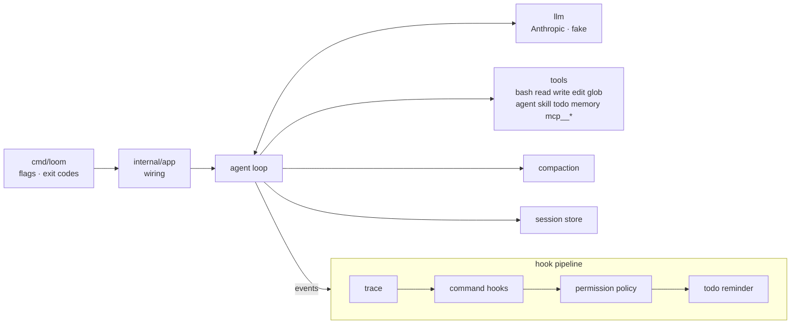

<div align="center">

# 🧵 loom

**A coding-agent harness in Go, built to be measured.**

One loop, a few sharp tools, and every seam exposed: events, hooks, permissions, traces.

[](https://github.com/xzwache/loom/actions/workflows/ci.yml)


[Quick start](#-quick-start) ·
[What works today](#-what-works-today) ·
[Architecture](#-architecture) ·
[Configuration](#-configuration) ·
[Roadmap](#-roadmap) ·
[Docs](#-docs)

</div>

---

## Why loom

Most agent repos stop at "it runs". loom aims for a harness you can **reason about and measure**:

- 🔌 **Everything is an event.** Permissions, tracing, todo reminders and user hooks all attach to one
  hook pipeline instead of being wired into the loop.
- 🧩 **An agent is just config.** Model, prompt sections, tool subset and budget. A subagent is the same
  type with a fresh history.
- 🤝 **Compatible with what you already have.** Claude Code hook scripts, `SKILL.md` folders,
  `AGENTS.md` / `CLAUDE.md`, and `.mcp.json` work unchanged.
- 🧪 **Testable without tokens.** A fake model replaying given replies drives the loop in unit tests.

The core follows the learn-claude-code sessions
s01–s10. The features planned on top are in [`references/loom-features.md`](references/loom-features.md).

---

## 🚀 Quick start

```bash
git clone https://github.com/xzwache/loom && cd loom
make build                      # → bin/loom
```

```bash
export ANTHROPIC_API_KEY=sk-ant-...
export LOOM_MODEL=claude-sonnet-5-5
```

```bash
bin/loom -p "find the flaky test in ./internal and explain why it fails"
```

Interactive mode (a TUI) is planned; today loom runs **headless**: one task in, one result out.

<details>
<summary><b>All flags</b></summary>

| Flag | What it does |
|---|---|
| `-p "<task>"` | Run this task without interaction and print the result |
| `-json` | With `-p`, print the result as JSON (`session_id`, `stop`, `text`, `turns`, `usage`) |
| `-trace` | With `-p`, record every event to `.loom/runs/<run-id>.jsonl` |
| `-continue` | With `-p`, continue the most recent session |
| `-resume <id>` | With `-p`, continue the session with this id |
| `-permission-mode <m>` | `default`, `acceptEdits`, `plan` or `bypassPermissions` |
| `-config <file>` | Extra config file, applied after the default ones |
| `-print-config` | Print the effective configuration as JSON and exit |
| `-quiet` | Log only warnings and errors |
| `-version` | Print the version and exit |

**Exit codes:** `0` done · `1` error · `2` usage · `3` stopped before finishing (budget, hook halt, …) · `130` interrupted

</details>

---

## ✅ What works today

| | Feature | Notes |
|---|---|---|
| 🔁 | **Agent loop** | Tool dispatch, `stop_reason` handling, clean stop with a reason |
| 🛠️ | **Built-in tools** | `bash`, `read`, `write`, `edit`, `glob`, with output truncation and path safety |
| ⏱️ | **Hard budgets** | Max turns, run tokens and wall-clock time; stops as `max_turns`, `max_run_tokens`, `timeout`, … |
| 📜 | **Run trace** | Every event as JSONL per run (`-trace`) |
| 🪝 | **Hooks** | Claude Code-compatible command hooks: JSON on stdin/stdout, exit 2 blocks. [docs](docs/hooks.md) |
| 🛡️ | **Permissions** | Allow / ask / deny rules by tool and pattern, four modes, shell parsing, an extend-only floor of blocked commands and protected paths |
| 🔐 | **Secret hygiene** | API keys and secret-like variables hidden from bash, hooks and MCP servers. [docs](docs/processes.md) |
| 💾 | **Sessions** | Saved per run; `-continue` and `-resume <id>` pick them up |
| 📝 | **Prompt sections** | Stable prefix + environment + `AGENTS.md` / `CLAUDE.md` / `LOOM.md` from user dir and repo |
| ☑️ | **Todo list** | `todo` tool with a reminder after N turns without an update |
| 👥 | **Subagents** | `agent` tool, built-in `general-purpose` and `explore` types, custom types in markdown; run in parallel with a shared token budget |
| 📚 | **Skills** | `SKILL.md` folders, catalog up front, instructions loaded on demand |
| 🗜️ | **Compaction** | Offload old tool output to disk first, summarize only when that is not enough. [docs](docs/compaction.md) |
| 🔌 | **MCP client** | stdio and HTTP servers from `.mcp.json`; project servers need explicit trust. [docs](docs/mcp.md) |
| 🧠 | **Memory** | Facts across sessions, saved by the model or extracted at session end, consolidated over time. [docs](docs/memory.md) |
| 🏷️ | **Text origins** | Every text block says who wrote it: user, model or loom. [docs](docs/messages.md) |
| 🤖 | **Headless mode** | `-p` with optional JSON output and meaningful exit codes |
| 🧪 | **Fake model** | `llmtest.Replay` runs the loop in tests with no API calls |

---

## 🏗️ Architecture



Two seams carry everything else:

1. **Events + hooks.** A hook answers with an `Outcome`: allow / ask / deny, rewritten input or output,
   extra context for the model, *block* (keep going) or *halt* (end the run). The trace runs first so it
   records everything; the permission policy runs after user hooks so it judges what they rewrote. A hook
   can tighten a decision, never loosen it.
2. **Agent spec.** An `Agent` is config. Subagents, cheap-model routing and session forking all reuse it.

<details>
<summary><b>Package map</b></summary>

```
cmd/loom              flags, config, run() -> exit code
internal/app          builds workspace, tools, hooks, agent and session from config
internal/agent        the loop: budgets, dispatch, compaction trigger, usage
internal/llm          message types, Model interface, Anthropic implementation
internal/llm/llmtest  fake model that replays given replies, for hermetic tests
internal/tool         Tool interface, Registry, built-ins (bash, read, write, edit, glob)
internal/event        typed, versioned lifecycle events
internal/hook         pipeline over events; command/ runs Claude Code-style scripts
internal/permission   rules, modes, shell parsing, floor rules
internal/prompt       system prompt from ordered sections
internal/todo         todo tool + reminder
internal/subagent     agent tool, agent types, parallel runs, shared budget
internal/skill        SKILL.md discovery and on-demand loading
internal/compact      compaction chain: offload, then summarize
internal/memory       memory store, tool, extraction and consolidation
internal/mcp          MCP client, server config and tools
internal/session      session, history, file store
internal/trace        JSONL trace subscriber
internal/config       typed, layered config
internal/childenv     environment filter for child processes
```

</details>

---

## ⚙️ Configuration

Layered, each source overriding the one before:

```
built-in defaults → ~/.config/loom/config.json → .loom/config.json → .loom/config.local.json → env vars → flags
```

Permission lists, floor rules and hooks **add up** across files. A few settings (`child_env.pass`,
`mcp.enabled_project_servers`) may only be set in the user config, so a repository cannot trust itself.

```json
{
  "model": "claude-sonnet-5-5",
  "max_turns": 50,
  "max_duration": "30m",
  "permissions": {
    "mode": "acceptEdits",
    "allow": ["Bash(go test *)", "mcp__github"],
    "deny": ["Bash(git push *)"]
  },
  "subagent": { "model": "claude-haiku-5-5", "max_parallel": 4 },
  "compaction": { "threshold": 0.8, "target": 0.5 },
  "hooks": {
    "PreToolUse": [{ "matcher": "Bash", "hooks": [{ "type": "command", "command": "./check.sh" }] }]
  }
}
```

Run `loom -print-config` to see what loom actually uses.

---

## 🗺️ Roadmap

### Core (learn-claude-code s01–s10)

| Step | | Status |
|---|---|---|
| s01 | Agent loop, `bash`, budgets, headless mode | ✅ |
| s02 | Tool registry + `read` `write` `edit` `glob` | ✅ |
| s03 | Permissions (rules, modes, floor) | ✅ |
| s04 | Events, hooks, trace, Claude Code command hooks | ✅ |
| s05 | Prompt sections, instruction files, todo + reminder | ✅ |
| s06 | Subagents with a fresh context (now parallel) | ✅ |
| s07 | Skills catalog and on-demand loading | ✅ |
| s08 | Compaction chain with reports | ✅ |
| s09 | Memory across sessions | ✅ |
| s10 | Persisted task graph with dependencies | ⬜ next |

### Next on the platform

- 🖥️ **TUI**: streaming output, diffs, permission prompt, slash commands (`/reload`)
- 📈 **Observability**: one sink for JSONL, structured logs, OpenTelemetry, cost and cache-hit reports
- ✏️ **User-editable prompts**: override `system.md` and agent types, `loom init-config`, `loom -print-prompt`
- 📄 **`loom init`**: the model drafts `AGENTS.md` for review

### Feature candidates

Collected in [`references/loom-features.md`](references/loom-features.md). Nothing beyond the core is decided.
★ = best value for the effort.

**Legend:** ✅ done · 🟡 partly there · ⬜ not started

<table>
<tr><td valign="top" width="50%">

#### 🏛️ Professional baseline
| | |
|---|---|
| Hard budgets (turns, tokens, time) | ✅ |
| Cost budget | ⬜ |
| Full run trace | ✅ |
| Fake model for tests | ✅ |
| Headless mode | ✅ |
| Usage report per run | 🟡 tokens + cache, no cost yet |
| Sandboxed execution | 🟡 permissions, no container yet |

#### 🌟 Stand-out
| | |
|---|---|
| ★ Deterministic replay | ⬜ |
| ★ Built-in ablations + `bench` | ⬜ |
| Context inspector | ⬜ |
| File checkpoints per turn | ⬜ |
| Pluggable compaction | 🟡 chain of strategies |
| Crash resume | 🟡 sessions persist |
| Independent verifier | ⬜ |
| Injection test suite | ⬜ |

#### 🔗 Ecosystem
| | |
|---|---|
| MCP client | ✅ |
| `SKILL.md` and `AGENTS.md` | ✅ |
| Hooks | ✅ |
| Editor protocol (ACP) | ⬜ |

</td><td valign="top" width="50%">

#### 🧱 Reliability
| | |
|---|---|
| ★ Edit tool with failure stats | ⬜ |
| ★ Stuck detection | ⬜ |
| Diagnostics after edits | ⬜ |
| Interrupt and steer | 🟡 clean Ctrl-C, no steering |
| Background commands | ⬜ |

#### 🔍 Code understanding
| | |
|---|---|
| Repo map (tree-sitter) | ⬜ |
| Parallel read-only tools | 🟡 parallel subagents |

#### 📊 Measurement and models
| | |
|---|---|
| ★ Terminal-Bench adapter | ⬜ |
| Model matrix | ⬜ |
| Cheap-model routing | 🟡 config only, not measured |
| Cache-aware context | 🟡 stable prefix, no hit-rate report |
| Session forking | ⬜ |

</td></tr>
</table>

<details>
<summary><b>What each candidate means, and its risk</b></summary>

| Feature | Idea | Risk |
|---|---|---|
| Hard budgets | Limits on turns, tokens, cost and time, with a clean stop and a reason | Easy to forget |
| Full run trace | Every request, response and tool call as JSONL | Traces can capture secrets from tool output |
| Fake model | Stand-in that replays given replies | Canned replies drift from real model behavior |
| Sandboxed execution | Commands run in a container, with permission rules | Docker adds setup friction |
| Usage report | Tokens, cache hits and cost at the end of a run | Prices change; keep them in config |
| ★ Deterministic replay | Re-run a recorded trace against changed harness code, no model calls | Works only while the change does not alter what the model saw |
| ★ Built-in ablations | Every feature behind a flag; `bench` prints a comparison table | Needs a task set; noisy on few tasks |
| Context inspector | `messages[]` per turn with each block's token share, manual pruning | UI work can eat the project |
| File checkpoints | Snapshot the tree each turn; rewind files and conversation together | Must go further than Claude Code's rewind |
| Pluggable compaction | Several strategies behind one interface, each measured | Hard to measure without long tasks |
| Crash resume | A killed process continues where it stopped | Half-finished tool calls may have side effects |
| Independent verifier | A separate context checks the work before "done" | Roughly doubles cost on short tasks |
| Injection test suite | Fixture repos with planted instructions; count how often the agent obeys | Depends heavily on the model |
| MCP client | Existing MCP servers' tools appear in the agent | Expected by now |
| Skills and project files | `SKILL.md` folders and `AGENTS.md` | Low; mostly parsing |
| Hooks | Scripts before and after tool calls that rewrite or block | Easy to design badly, hard to change |
| Editor protocol | Agent Client Protocol so editors such as Zed can drive loom | Young spec |
| ★ Edit failure stats | Several edit formats, each with a measured failure rate | Tedious; varies by model |
| ★ Stuck detection | Notice repeated calls or no progress, then intervene or stop | False positives interrupt retries |
| Diagnostics after edits | Run linter / type checker after each edit, feed errors back | Slow on big projects |
| Interrupt and steer | Ctrl-C mid-turn without corrupting history, then type a correction | Tool-use pairs must stay valid |
| Background commands | Long builds run without blocking; notify on finish | Concurrency bugs |
| Repo map | Compact tree-sitter symbol index up front, as Aider does | May not beat `grep` on small repos |
| Parallel read-only tools | Run several `read` / `grep` calls from one response at once | Small gain unless search-heavy |
| ★ Terminal-Bench adapter | A public score comparable with other agents | Modest score; runs cost money |
| Model matrix | Same tasks across several models, a local one included | Cost, per-model prompt quirks |
| Cheap-model routing | Subagents and exploration on a cheaper model, difference measured | Quality drops can be subtle |
| Cache-aware context | Stable prompt prefix on purpose; cache hit rate per run | Constrains compaction and memory |
| Session forking | Branch a run at any turn and compare two approaches | Files need branching too |

</details>

---

## 🧑‍💻 Development

```bash
make check              # vet + golangci-lint + go test -race (run before every PR)
```

```bash
make test-integration   # calls the real API; needs ANTHROPIC_API_KEY and costs money
```

Code, tests and git work follow [`docs/STANDARDS.md`](docs/STANDARDS.md):
small PRs, one concept per package, policy as data, no AI attribution in commits.

---

## 📖 Docs

| Doc | About |
|---|---|
| [`docs/PLAN.md`](docs/PLAN.md) | Core plan, event catalog, upcoming design work |
| [`docs/STANDARDS.md`](docs/STANDARDS.md) | Engineering standards |
| [`docs/hooks.md`](docs/hooks.md) | Hook pipeline, outcomes, what each event accepts |
| [`docs/research/permissions.md`](docs/research/permissions.md) | How the permission model was designed |
| [`docs/compaction.md`](docs/compaction.md) | Offload-then-summarize compaction |
| [`docs/mcp.md`](docs/mcp.md) | MCP client setup and trust |
| [`docs/memory.md`](docs/memory.md) | Memory storage, selection and extraction |
| [`docs/messages.md`](docs/messages.md) | Text origins and loom notes |
| [`docs/processes.md`](docs/processes.md) | Child processes and environment filtering |
| [`references/loom-features.md`](references/loom-features.md) | All feature candidates |
