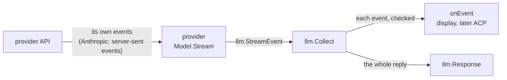

# Streaming

Every model reply is streamed: the text, thinking and tool input arrive in pieces, so a UI can
show them as they come. The pieces are loom's own types, the same for every provider.

## The parts



| Part | File | What it does |
|---|---|---|
| `llm.Model` | `internal/llm/llm.go` | one method: `Stream(ctx, req) iter.Seq2[StreamEvent, error]` |
| stream events | `internal/llm/stream.go` | `BlockStart`, `TextDelta`, `ThinkingDelta`, `SignatureDelta`, `ToolInputDelta`, `BlockStop`, `MessageStop` |
| `llm.Collect` | same | builds the `Response` from a stream, checks the order, shows each event to a callback |
| `llm.Send` | same | `Collect` with no callback, for callers that want the whole reply (summaries, memory) |
| Anthropic | `internal/llm/anthropic.go` | turns the API's server events into stream events |
| `llmtest.Events` | `internal/llm/llmtest/replay.go` | turns a `Response` into a stream, text in several pieces; `Replay` uses it |

## A stream

For each content block, in index order: a `BlockStart`, its deltas, a `BlockStop`. Then one
`MessageStop` with the stop reason and the usage of the whole request.

```
BlockStart{0, Text{}}
TextDelta{0, "Listing "}
TextDelta{0, "files."}
BlockStop{0}
BlockStart{1, ToolUse{ID: "tu_1", Name: "bash"}}
ToolInputDelta{1, `{"command": `}
ToolInputDelta{1, `"ls"}`}
BlockStop{1}
MessageStop{StopReason: tool_use, Usage: {...}}
```

Blocks may be open at the same time (some providers stream several tool calls at once), but each
one starts with the next index. `RedactedThinking` comes whole in its `BlockStart`.

## What `Collect` checks

The rules live in one place, so a provider only translates. Each break is
`ErrUnexpectedResponse`:

- a delta for a block that is not open, or of the wrong kind (tool input for a text block);
- a block started out of order or twice;
- the message stopping with a block still open, an event after it, or no `MessageStop` at all;
- an unknown stop reason;
- tool input that is not valid JSON once its block stops.

One exception: a reply cut off at `max_tokens` can end inside a tool's input. Then the input
becomes `{}` and the stop reason `max_tokens` reports the cut (the loop stops as `truncated`).

An error from the stream itself, such as a broken connection or an API error, is returned as it is.

## Retries and cancel

- The Anthropic SDK retries a request only before the stream starts (429, 5xx, 529). An error
  in the middle of a stream is not retried: the turn fails with that error.
- Cancelling the ctx closes the connection; `Collect` returns `context.Canceled`, and the loop
  stops as `cancelled`.

## Adding a provider

Implement `Stream`: send the request, and for each of the provider's events yield the matching
stream events. Number the blocks yourself if the provider does not. Usage that comes in parts
(Anthropic sends input tokens first, output tokens at the end) is added up and sent in
`MessageStop`.

## Next

The loop collects with no callback for now. Display events (`docs/tui.md`, phase 1) will fire from
the stream events, and `loom acp` sends them as `session/update`.
