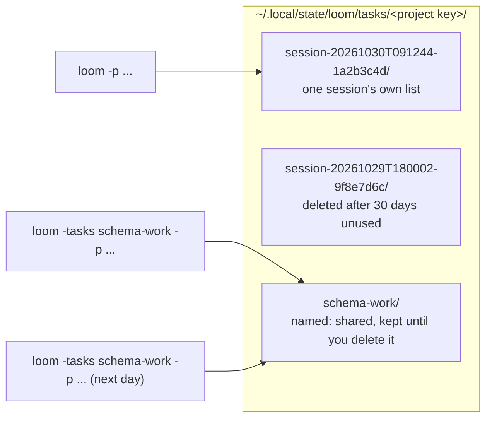
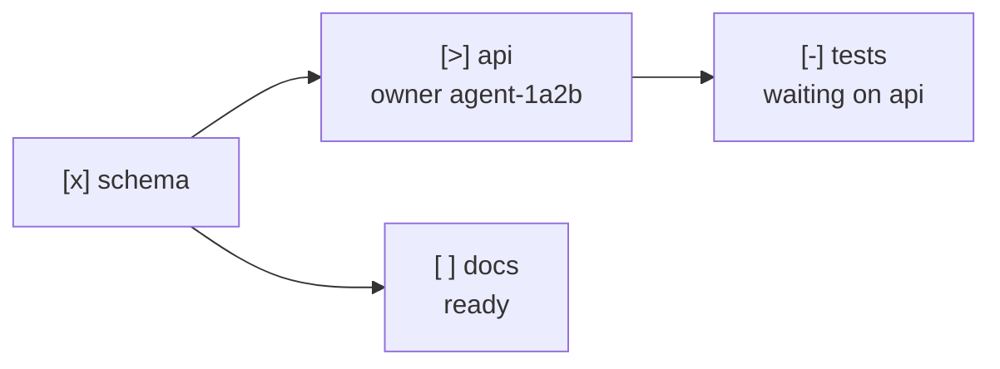
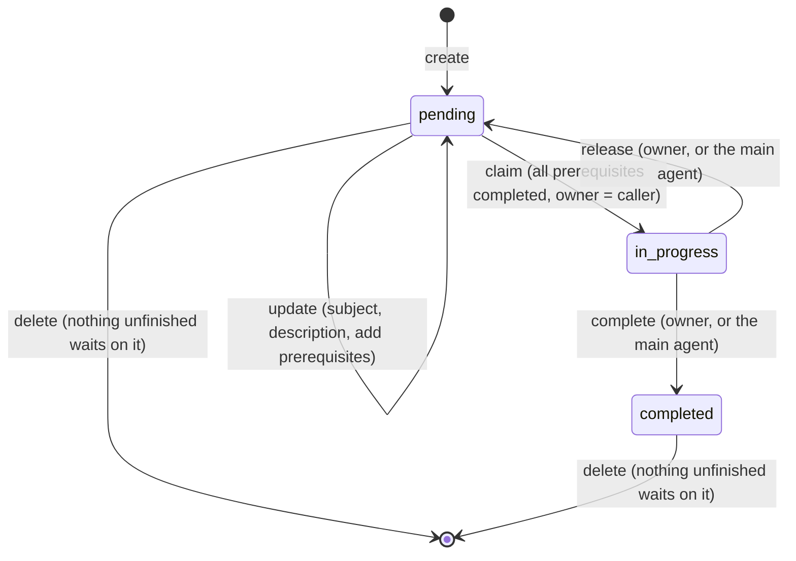
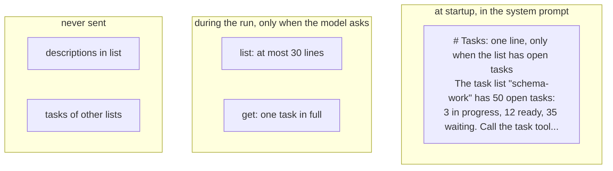
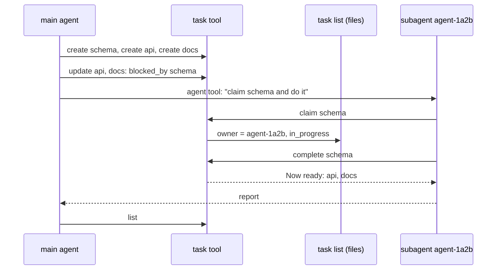

# Task graph

Tasks that wait on other tasks and record which agent works on them. learn-claude-code s10, scoped
the way Claude Code scopes its task lists. For the steps of the current work, the model keeps a todo
list instead (`docs/todo.md`).

## Lists: one per session, or a named one you share

Tasks live in a **list**. By default each session gets a list of its own, so a new session never
inherits old tasks. To carry work across sessions, or to have two loom processes work from the same
tasks, pick a **named list**:

```
loom -tasks schema-work -p "plan the schema migration"
loom -tasks schema-work -p "continue with the next ready task"
```

or in config: `{"tasks": {"list": "schema-work"}}`. The flag overrides the config.



| | Session list | Named list |
|---|---|---|
| folder | `session-<session id>` | the name you pick |
| used by | that session, and `-resume`/`-continue` of it | every session started with that name |
| deleted | automatically, `tasks.retention` (30 days) after its last change | never by loom; delete the folder yourself |
| name rule | made by loom | 1-64 of `a-z 0-9 - _`, not starting with `session-` |

The project key is the one memory uses (folder name + hash of its path), so a name means a
different list in each workspace. Lists are kept out of the repository for the same reason memory
is: the model acts on tasks, so a repository must not be able to plant them.

## A task

One JSON file per task in its list's folder:

```json
{
  "id": "task_81d0b7aa",
  "subject": "add the REST endpoints",
  "description": "GET and POST /users, using the schema from task_3f9a1c2e",
  "status": "pending",
  "blocked_by": ["task_3f9a1c2e"],
  "created": "2026-10-30T09:12:44Z"
}
```

| Field | Rule |
|---|---|
| `id` | `task_` + 8 hex characters, made by loom |
| `subject` | one line, at most 200 characters |
| `description` | at most 4000 characters: what someone needs to do it without this conversation |
| `status` | `pending`, `in_progress` or `completed` |
| `owner` | the agent that claimed it: `main`, or a subagent's id (`agent-1a2b3c4d`); kept after completion |
| `blocked_by` | the prerequisites: ids of tasks that must be completed first |

## Prerequisites: the graph



An arrow means "must be completed before". A task is **ready** when it is pending and every task in
its `blocked_by` is completed. A blocker that is missing or unreadable counts as not completed.

| Group | Mark | Meaning |
|---|---|---|
| in progress | `[>]` | claimed, being worked on |
| ready | `[ ]` | pending, every prerequisite completed: can be claimed now |
| waiting | `[-]` | pending, some prerequisite not completed |
| completed | `[x]` | done |

## Status



- Only a **pending** task can be changed or claimed.
- Only the **owner** can complete or release a task, so two subagents cannot finish each other's
  work. The main agent may do both for any task: a subagent that stopped leaves its task in
  progress, and someone has to finish it or hand it back.
- **Delete** refuses a task in progress (release it first) and a task that an unfinished task waits
  on (delete those first), so deleting never leaves a task blocked for good.

## The `task` tool

One tool, with an action, like `memory`:

| Action | Input | Result |
|---|---|---|
| `create` | `subject`, optional `description`, `blocked_by` | the new task, with its id |
| `update` | `id`, any of `subject`, `description`, `blocked_by` (added to the existing ones) | the task |
| `list` | optional `status`: `in_progress`, `ready`, `waiting`, `completed` | at most 30 tasks, see below |
| `get` | `id` | the task in full: prerequisites and description |
| `claim` | `id` | it is yours now |
| `complete` | `id` | done, and the tasks that just became ready |
| `release` | `id` | pending again, no owner |
| `delete` | `id` | removed |

### `list` is capped

`list` shows at most **30** tasks, what needs attention first: in progress, then ready, then
waiting. Descriptions are left out; `get` shows them. What does not fit is counted, never dropped
silently:

```
[>] task_81d0b7aa add the REST endpoints (owner agent-1a2b3c4d)
[ ] task_5c11e9f0 write the docs
[-] task_0a7d2b64 add the tests (waiting on task_81d0b7aa (in_progress))
... up to 30 lines
(not shown: 12 waiting; list with a status to see them)
(4 completed; list with status completed to see them)
```

With a `status`, only that group is shown, under the same cap. So with 50 open tasks, one `list`
costs about 30 lines (roughly 1,000 tokens), never all 50, and the model asks for the rest by group.

### Building a graph

Every `create` returns an id loom makes. When the model sends several calls in one response, none
of them can know the others' ids yet. So it builds a graph in two steps: create every task, then
link them with `update` and the returned ids. A `create` can name prerequisites that already exist.

### Checks

Every change is checked against the whole list before anything is written; a failed check is an
error result and changes nothing:

- every prerequisite exists, and a task cannot be its own;
- no cycle: adding `B` as a prerequisite of `A` fails when `B` already waits on `A`, directly or
  through other tasks;
- a prerequisite listed twice is added once;
- ids must match `task_` + 8 hex characters, so an id can never be a path.

If any task file is unreadable, `list` shows it as `Not readable: …` and every change fails until
it is fixed or removed, since the broken file might be a prerequisite or close a cycle.

## What reaches the model's context



| In the context | How |
|---|---|
| the tool definition | in every request's `tools`, cached |
| when to use it | one line in `internal/prompt/system.md` |
| a summary of the open tasks | `# Tasks`, one line at the end of the system prompt, after the project instructions and before `# Memory`; only when the list has open tasks, so a new session list adds nothing |
| each call and result | in the history, like any tool |

The summary is built at startup and again after each compaction (`Agent.RebuildSystem`), like the
memory list: changing the system prompt between compactions would lose the cached prefix. Between
compactions the model's own `task` results are the newer truth.

## Who uses it



- **Main agent and subagents** share the session's list. `task` is in the default
  `subagent.tools`, so a subagent can claim and complete the task it was given; an agent type that
  lists its tools gets `task` only if it lists it (the built-in `explore` does not).
- **Owner** comes from who is calling: `main` for the main agent, the subagent's id otherwise.
- **Parallel subagents** claiming at the same time: the store takes one lock per change, so
  exactly one claim wins and the others get "task … is in_progress (owner …)".
- **Two loom processes** on the same named list are not locked against each other yet.

## Compared with Claude Code

From the Claude Code docs (`tools-reference`, `interactive-mode`, `agent-teams`, `hooks`,
`claude-directory`, `env-vars`), checked 2026-10-30. Where the docs say nothing, it says so.

| | Claude Code | loom |
|---|---|---|
| tools | `TaskCreate`, `TaskGet`, `TaskUpdate`, `TaskList` | one `task` tool with actions |
| stored | `~/.claude/tasks/`, one folder per list | `~/.local/state/loom/tasks/<project key>/`, one folder per list |
| scope | per session by default (not stated outright); `CLAUDE_CODE_TASK_LIST_ID=name` shares a list | per session by default; `-tasks name` or `tasks.list` shares a list, per workspace |
| cleanup | all lists after `cleanupPeriodDays` (30) | session lists after `tasks.retention` (30 days); named lists kept |
| delete | `TaskUpdate` with status `deleted` | `delete`, refused while something unfinished waits on it |
| at startup | not documented (the docs mention task "reminders" in context) | one summary line when the list has open tasks |
| list output | "all tasks with their current status"; no documented cap | at most 30, in progress and ready first, the rest counted |
| prerequisites | a task can depend on others and shows blocked until they are done | `blocked_by`, with cycle checks |
| claiming | file locking | one lock per process |
| stuck in progress | the docs: "update the task status manually or tell the lead" | the main agent may complete or release any task |
| hooks | `TaskCreated` and `TaskCompleted` can block | notices only (see Later) |
| todo list | `TodoWrite` off by default, replaced by the task tools | both: todo for the steps of the current work |

## Events

| Event | Fields | When |
|---|---|---|
| `TaskCreated` | `task_id`, `subject` | a task was created |
| `TaskCompleted` | `task_id`, `subject`, `owner` | a task was completed |

Both are notices: hooks can watch them (the trace records them) but cannot change or block them.

## Permissions

`task` changes only loom's own state, so it is allowed in every mode, `plan` included: planning
work is what plan mode is for. A deny rule turns it off: `{"permissions": {"deny": ["task"]}}`.

## Settings

| Setting | Flag | Default | Meaning |
|---|---|---|---|
| `tasks.list` | `-tasks` | empty | a named list sessions of this workspace share; empty gives each session its own |
| `tasks.retention` | | `720h` (30 days) | session lists unchanged this long are deleted at startup |

## Code

| File | What |
|---|---|
| `internal/task/task.go` | `Task`, checks, `Store` (create, get, list, edit, claim, complete, release, delete; one lock, files written through a temporary file) |
| `internal/task/list.go` | groups, the capped `list` result (`Render`), the prompt line (`Summary`) |
| `internal/task/dir.go` | list names, `PruneSessionLists` |
| `internal/task/tool.go` | the `task` tool; owner from the calling agent |
| `internal/app/build.go` | `addTasks` step (picks the list, prunes, registers the tool); `newAgent` adds the summary |

## Later

- A lock file, so two loom processes can share a named list safely.
- Hooks that may block `TaskCreated` and `TaskCompleted` (for example until the tests pass), as
  Claude Code allows.
- A `loom tasks` command to see and delete named lists without the model.
- TUI: a task panel.
