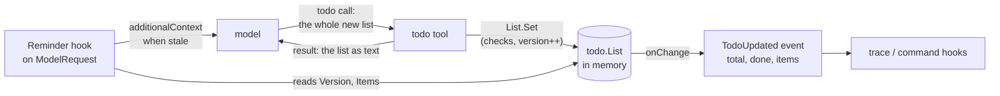
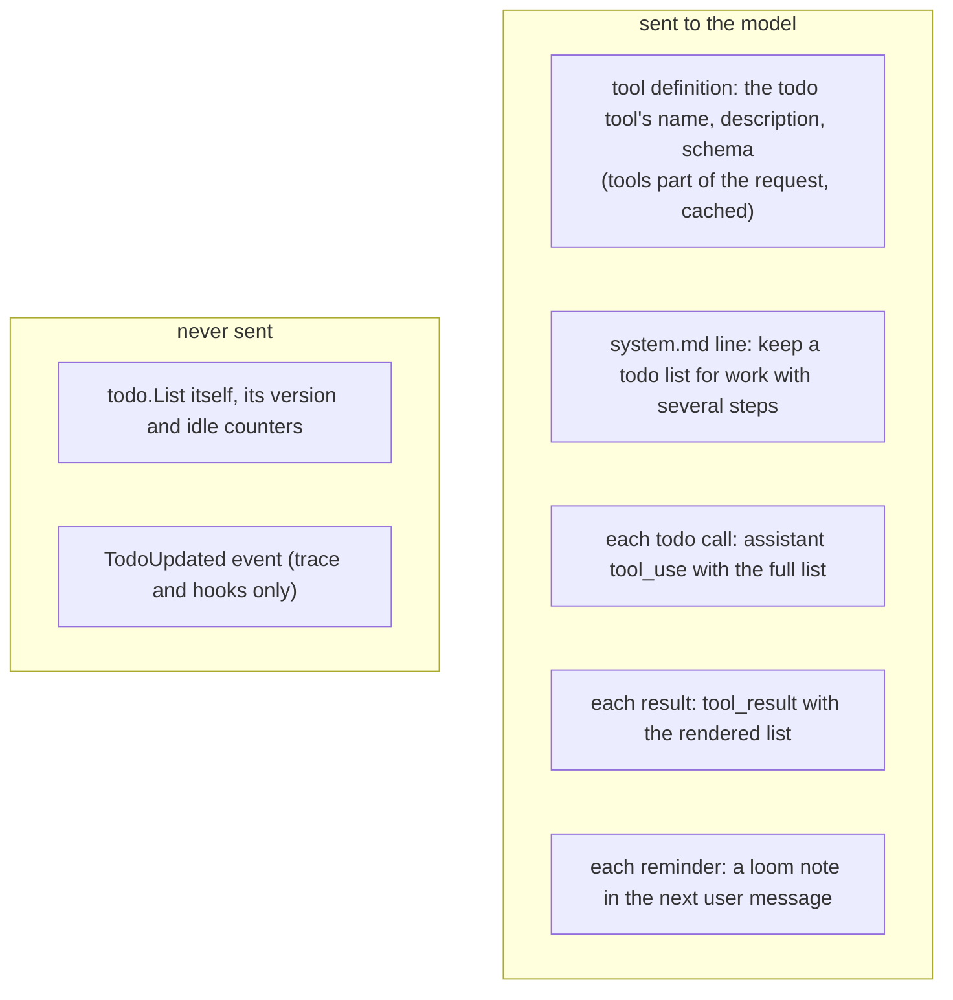

# Todo list

The model's checklist for the work in front of it: the steps, which one it is on, which are done.
learn-claude-code s05. It lives in memory for one session; for work whose parts depend on each other,
or that must survive a restart, see the task graph (`docs/tasks.md`).

## The parts



| Part | File | What it does |
|---|---|---|
| `todo.List` | `internal/todo/todo.go` | holds the items and a version number that goes up on every change; safe for concurrent use |
| `todo.Tool` | same | the `todo` tool: replaces the whole list, returns it rendered |
| `todo.Reminder` | same | a `ModelRequest` hook that nudges the model when an open list goes stale |
| wiring | `internal/app/build.go` | `addTools` makes one list per session and the tool; `addHooks` adds the reminder last |

## How the list is updated

The model never edits one item: every call sends **the whole list**, and it replaces the old one.

```json
{"todos": [
  {"content": "read the config loader", "status": "completed"},
  {"content": "add the timeout field",  "status": "in_progress"},
  {"content": "run make check",         "status": "pending"}
]}
```

`List.Set` checks the new list before it takes it; a bad list is an error result, and the old list
stays:

- every item has content;
- status is `pending`, `in_progress` or `completed`;
- at most one item is `in_progress` (one thing at a time).

On success the version goes up, `TodoUpdated{total, done, items}` fires (a notice: hooks can watch it, not
change it), and the result is the list as text:

```
[x] read the config loader
[>] add the timeout field
[ ] run make check
```

An empty list is allowed; that is how the model clears it.

## The reminder

```mermaid
sequenceDiagram
    participant Loop as agent loop
    participant R as Reminder
    participant L as List
    Loop->>R: ModelRequest (turn 1)
    R->>L: Version()
    Note over R: version changed: idle = 0, say nothing
    Loop->>R: ModelRequest (turn 2)
    Note over R: same version: idle = 1
    Loop->>R: ModelRequest (turn 3)
    Note over R: idle = 2
    Loop->>R: ModelRequest (turn 4)
    Note over R: idle = 3 = After, list has open items
    R-->>Loop: additionalContext: reminder + current list
    Note over R: idle = 0, next one in 3 more turns
```

- It counts model requests of the **main agent** since the list last changed. Subagent requests
  are skipped.
- It speaks only when the count reaches `todo_reminder_turns` (default 3) **and** the list has an
  item that is not `completed`. A finished or empty list is never nagged about.
- `todo_reminder_turns: 0` turns it off.

The text it adds:

```
<system-reminder>Your todo list has not changed for 3 turns. If your progress changed, update it
with the todo tool. Current list:
[x] read the config loader
[>] add the timeout field
[ ] run make check
</system-reminder>
```

## What reaches the model's context



| In the context | How |
|---|---|
| the tool definition | in every request's `tools`, before the system prompt, so it is cached |
| the instruction to use it | one line in `internal/prompt/system.md` |
| every list the model wrote | its own `tool_use` input stays in the history |
| every result | the `tool_result` text, the same list rendered |
| reminders | appended to the last user message as `<loom-note kind="hook_context">` around the `<system-reminder>`; they stay in the history like any message |

| Not in the context | Why |
|---|---|
| the current list on its own | the model already sees its last call and result; nothing is re-sent each turn |
| the version and idle counters | loom's bookkeeping |
| `TodoUpdated` | an event for the trace and command hooks, not a message |

So the list costs tokens only when the model writes it, and once more per reminder.

## Lifetime

- **One list per session**, in memory. It is not saved in the session file: after `-resume` the
  list starts empty, but the old `todo` calls are still in the resumed history, so the model can
  see what it last wrote and send it again.
- **Compaction**: old `todo` calls and results can be offloaded or summarized away like any other
  tool output; the summary does not carry the list. If the list is still open, the reminder brings
  it back within `todo_reminder_turns` turns.
- **Subagents** never get the `todo` tool: it is in `tool.MainOnly`, and listing it in
  `subagent.tools` is a config error. The list is the main agent's plan; a subagent has one task.
  The reminder also skips subagent requests.

## Permissions

`todo` changes only loom's own state, so it is treated as read-only and allowed in every mode,
`plan` included. A deny rule turns it off: `{"permissions": {"deny": ["todo"]}}`.

## Settings

| Setting | Default | Meaning |
|---|---|---|
| `todo_reminder_turns` | `3` | main-agent model turns an open list may stay unchanged before a reminder; `0` turns it off |

## Todo list or task graph

| | todo | task (`docs/tasks.md`) |
|---|---|---|
| for | the steps of the current work | units of work that depend on each other |
| stored | in memory, one session | a file per task in loom's state folder; one list per session, or a named list sessions share |
| update | replace the whole list | one task at a time, by id |
| order | the list order | `blocked_by` dependencies |
| who | the main agent | any agent, recorded as `owner` |
